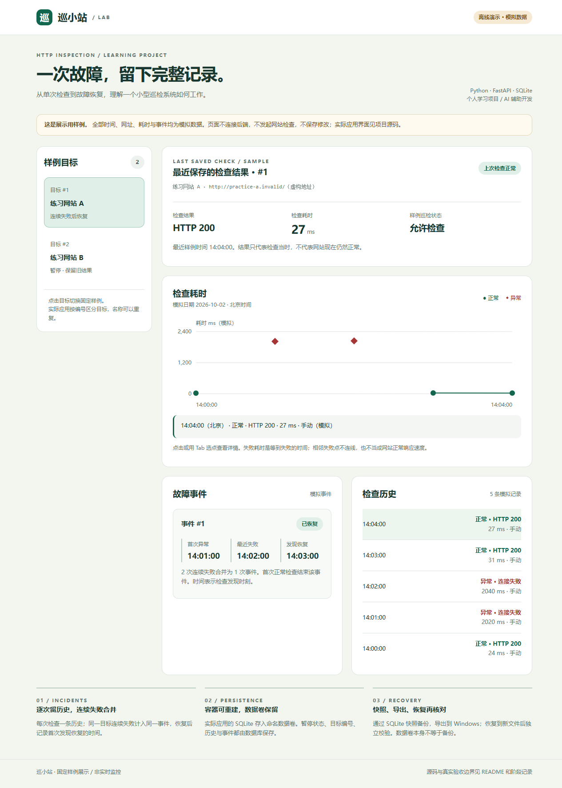
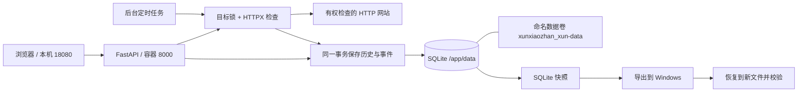

# 巡小站

**一个能记录检查、追踪故障恢复，并练习容器部署与备份的 HTTP 巡检学习项目。**

使用 Python、FastAPI、HTTPX、SQLite 和原生 JavaScript，支持 Docker Compose 本机运行。
这是 AI 辅助开发的个人学习项目；功能在本机可控服务上演练，不作为企业生产运维或高可用能力的证明。

## 先看项目

- [离线交互演示](docs/demo/index.html)：下载仓库后用浏览器打开；全部为模拟数据，不请求网站、不读取运行库。GitHub 文件页展示的是源码。
- [架构与数据流](docs/architecture.md)：检查流程、进程锁、数据卷与备份去向。
- [项目讲解提纲](docs/showcase.md)：一分钟介绍、演示顺序、真实证据与能力边界。
- [本轮展示验收](docs/stage-14-showcase.md)：离线演示验证范围和亲手检查步骤。
- [操作手册](docs/usage.md)：原有启动、接口、逐项演练、测试与排障步骤完整保留。

上图来自独立静态演示页，实际应用界面为 app/static/index.html；演示页不代表实时监控结果。

## 已实现什么

| 能力 | 行为与边界 |
| --- | --- |
| 多目标管理 | 按不可复用的编号操作；名称允许重复，网址去重；暂停状态持久化 |
| 手动与定时检查 | 共用检查流程；默认每次完成后等待 60 秒；单次总时限 10 秒；最终 HTTP 2xx 为正常 |
| 历史与故障事件 | 每次检查存历史，连续失败合并事件，首次正常检查记录恢复；暂停不等于恢复 |
| 耗时图 | 最近 20 次记录可选点查看；失败耗时保留，失败与网址变化处断线 |
| 容器运行 | 单 worker、普通用户运行、仅发布本机 18080；SQLite 挂载命名卷 |
| 备份恢复 | SQLite 快照 → 导出到 Windows → 恢复到新文件 → 独立校验，拒绝覆盖旧文件 |

完整行为、错误响应与接口列表见[操作手册](docs/usage.md)。

## 架构概览

调度运行在后端，关闭浏览器不会停止它；停止后端或电脑则停止检查。
GET /api/health 只表示接口可响应，不能证明数据库和目标网站健康。

## 本机启动

已验证环境：Windows 11 + WSL2 + Docker Desktop，Linux 容器使用 Python 3.13.15。
以下 PowerShell 示例适用于当前 Windows 每用户安装的 Docker Desktop；安装目录不同需调整 dockerBin。
进入项目根目录后执行：

~~~powershell
$dockerBin = Join-Path $env:LOCALAPPDATA 'Programs\DockerDesktop\resources\bin'
$dockerExe = Join-Path $dockerBin 'docker.exe'
$env:PATH = "$dockerBin;$env:PATH"
& $dockerExe compose up -d --build
& $dockerExe compose ps
~~~

打开 http://127.0.0.1:18080/。端口被占用时先核对项目，修改映射后再启动，不停止不明服务。

首次启动会生成独立数据库，默认目标 127.0.0.1:8765 指向容器自己；容器中没有该测试网站时检查会失败。
可先将练习目标改为 http://127.0.0.1:8000/api/health 验证自身接口，再按[网络练习](docs/stage-11-container-network.md)访问 Windows 测试网站。

~~~powershell
& $dockerExe compose stop
& $dockerExe compose start
~~~

stop/start 保留原容器；普通 down/up 会重建容器并复用命名卷。不要添加 down -v，它会删除数据卷。
Windows 原 data 目录与 Docker 命名卷是两份独立数据。[重建演练](docs/stage-12-container-data.md) / [备份与导出](docs/stage-13-container-backup.md)。

无需 Docker 的本机 Python 运行方法见[操作手册](docs/usage.md)。

## 验证过什么

以下是截至 2026-10-02 的本机学习验证，不是生产性能数据或可用性承诺。

| 证据 | 验证结论 | 记录 |
| --- | --- | --- |
| Python 自动测试 | 49 项在 Linux 容器中通过，覆盖检查、暂停、并发保护、事件、备份等 | [容器运行](docs/stage-10-container-run.md) |
| 图表浏览器验证 | 选点、断线、空值及窄屏等已用 Edge 测试 | [耗时图](docs/stage-07-response-chart.md) |
| Windows 测试网站 | 容器检查经历 200 → 连接失败 → 200，事件记录恢复 | [网络验收](docs/stage-11-container-network.md) |
| 容器重建 | 原命名卷保留；学习者核对 2 个目标、51 条检查、3 次事件 | [数据保留](docs/stage-12-container-data.md) |
| 备份导出与恢复 | 容器和 Windows 快照哈希一致；恢复副本校验通过，五项统计一致 | [备份验收](docs/stage-13-container-backup.md) |

自动测试使用临时数据库和可控服务；独立重建、备份测试使用明确标注的模拟数据。
实际练习库恢复到新文件，未将运行应用切换到恢复库。49 项是当时的测试结果；文档和静态展示修改不代表重新执行了全部应用测试。

## 当前边界

- 无登录鉴权、通知告警或自动修复，仅用于可信本机环境，不能直接暴露公网。
- 每个运行数据库只允许一个应用进程；后台串行调度少量目标，不保证精确整分钟执行或高可用。
- 只依据 HTTP 响应头与状态码，不能证明登录、订单等业务流程正常；证书错误尚未与其他连接失败细分。
- 事件时间是检查发现时刻，不能直接作为精确故障起止时间；暂停期间没有新采样。
- 历史与事件界面各显示最近 20 条，更早记录仍在库内，暂不自动清理、分页或统计 SLA。
- 同机导出不等于异地备份；未做整机故障恢复与运行库切换演练。

## 目录

~~~text
app/                  API、调度、数据库、备份工具与实际网页
examples/windows-site/ 可控的 Windows 静态测试网站
tests/                Python 自动测试与可选浏览器验证
Dockerfile            应用镜像
compose.yaml          本机端口与命名数据卷
docs/usage.md         操作手册
docs/architecture.md  架构与数据流
docs/showcase.md      讲解提纲与证据边界
docs/demo/index.html  离线演示，固定模拟数据
docs/stage-*.md       分轮实现与用户验收记录
~~~

.venv、运行数据库、备份与私人日志均被 Git 忽略。数据库备份与代码提交是两件不同的事。
本地提交完成不代表已发布；远程推送与公网部署另行决定。
