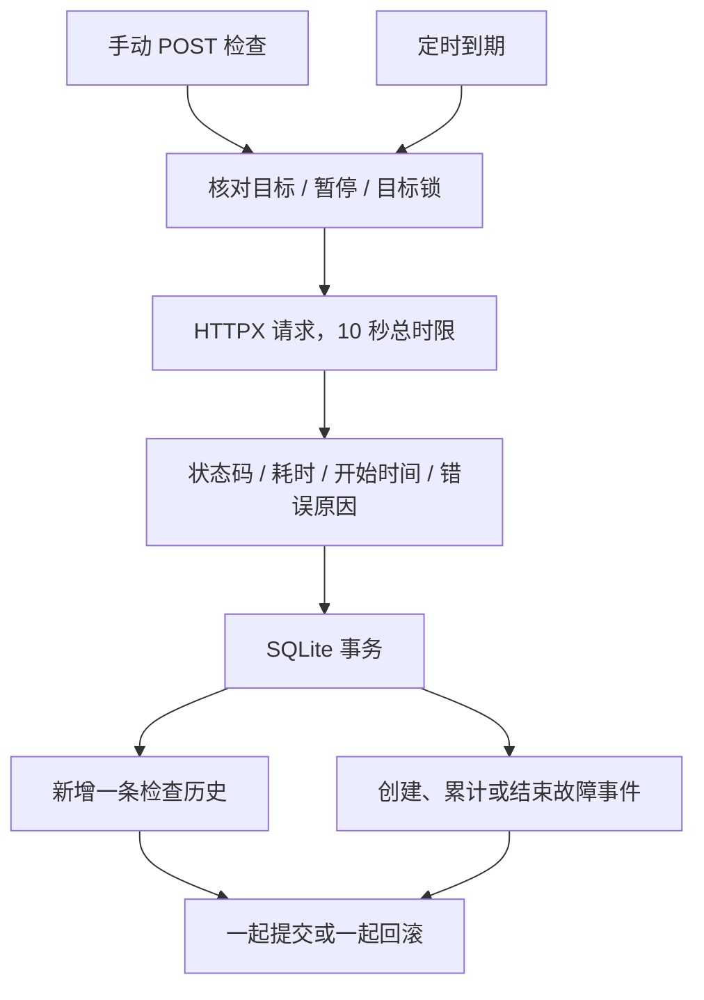
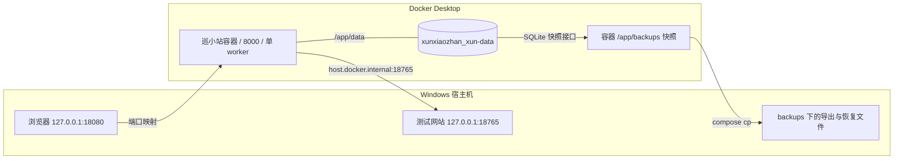

# 架构与数据流

[返回项目首页](../README.md) · [操作手册](usage.md)

## 两条检查入口，一个执行流程

浏览器通过带目标编号的 API 发起手动检查；后端 Scheduler 查找到期且未暂停的目标。
两者进入 app/main.py 的 perform_check / inspect_and_save 流程，共用目标锁、HTTPX 客户端及保存逻辑。
目标锁使同一编号的检查、配置修改、暂停或删除不重叠；不同编号使用不同锁。
另有跨进程文件锁，阻止多个应用进程同时使用同一数据库。

HTTPX 流式读取到最终响应头，不读取全文；最多 5 次重定向、验证 TLS、不继承系统代理环境变量。
最终 200–299 为正常，其他状态、连接错误和超时为异常。失败耗时表示等待失败的时间。
HTTPX 异步执行网络请求，SQLite 操作通过 asyncio.to_thread 执行。

## 数据库保存四类信息

| 表 | 用途 |
| --- | --- |
| targets | 当前名称、网址和暂停状态，使用独立目标编号 |
| target_id_sequence | 保存已分配最大目标编号，删除后不回退 |
| checks | 每次检查结果和当时配置的快照，含手动/定时来源 |
| incidents | 连续失败合并记录，保存首次异常、最近失败、次数及结束原因 |

同名目标可以并存；界面与后端通过编号定位目标，不能依赖名称唯一。
删除目标会同时删除其历史与事件；新建目标不会复用旧编号。
暂停保留未恢复事件；修改名称不结束事件；修改网址以 url_changed 结束旧事件，不伪称恢复。

## Windows 与容器的边界

容器自己的 127.0.0.1 不指向 Windows。上述回环服务访问已在这台 Windows + Docker Desktop 上实测，不直接推断所有 Linux 环境同样可用。
普通 down 删除容器，命名卷保留；up 创建新容器后重新挂载。未挂载卷的目录属于容器可写层。
/app/backups 当前没有挂载卷，所以必须导出备份。恢复工具写入新文件，当前没有自动切换运行数据库的功能。

## 调度和健康状态的边界

默认等待上一检查完成后 60 秒再检查，间隔范围为 30–86400 秒。手动检查、保存配置或恢复会推迟下次检查。
启动后重新等待间隔，不补跑停机期间的任务；关闭浏览器不停止调度，后端退出则停止。
/api/health 的成功只能证明接口可响应；/api/scheduler 的 running 只能说明调度任务存活。
这两个字段均不能替代目标检查和数据库校验。
